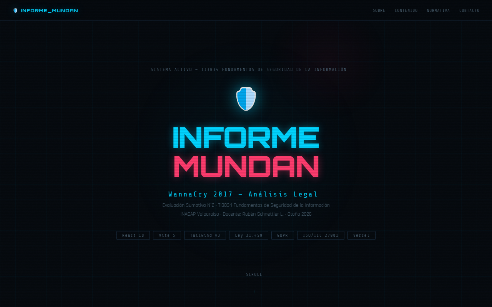

# 🛡️ informe_mundan · Presentación

[](https://github.com/Fernandamv96/Presentaci-n-mundan/actions/workflows/ci.yml)
[](LICENSE)

Presentación web de una sola página para exponer el **análisis legal del caso WannaCry (2017)**, complemento de [informe-mundan](https://github.com/Fernandamv96/informe-mundan). Ramo TI3034 · Fundamentos de Seguridad de la Información (INACAP Valparaíso).

**Demo:** <https://presentaci-n-mundan.vercel.app/informe-mundan-presentacion.html>



## ¿Qué problema resuelve?

Resume en formato de exposición los 8 puntos del informe (incidente, normativa, delitos, responsabilidades y conclusiones), con enlaces directos al informe completo y un código QR para la audiencia.

## Stack

HTML + CSS + JavaScript en un solo archivo, sin build. Desplegado en Vercel.

## Cómo correrlo localmente

Abre `informe-mundan-presentacion.html` en el navegador, o:

```bash
npm ci && npm start     # http://localhost:8000/informe-mundan-presentacion.html
npm run lint            # html-validate
```

## Estructura del proyecto

```text
├── informe-mundan-presentacion.html   # toda la presentación
└── vercel.json                         # "/" → informe-mundan-presentacion.html
```

## 🔒 Calidad y seguridad

- CI en cada push y PR: `html-validate`, además de CodeQL, Dependabot y gitleaks en pre-commit.
- Para reportar vulnerabilidades, mira [SECURITY.md](SECURITY.md).

## 💡 Qué aprendí

- A sintetizar un informe legal extenso en una narrativa para exponer.
- Que un sitio sin `index.html` responde 404 en la raíz: se corrigió con un rewrite en `vercel.json`.

## 📄 Licencia

[MIT](LICENSE) © 2026 Fernanda (Fernandamv96)
